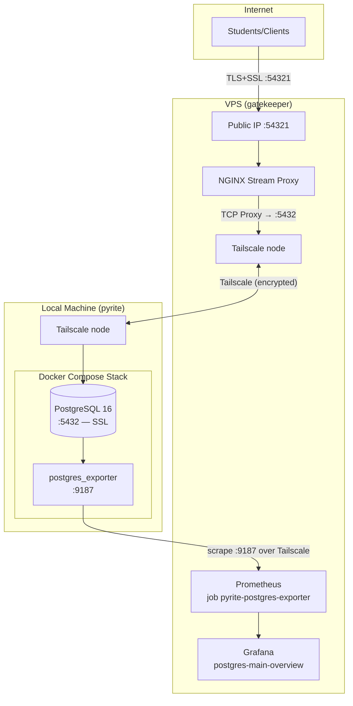
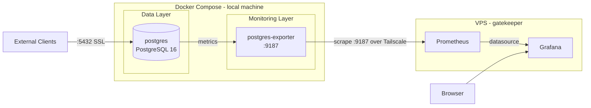
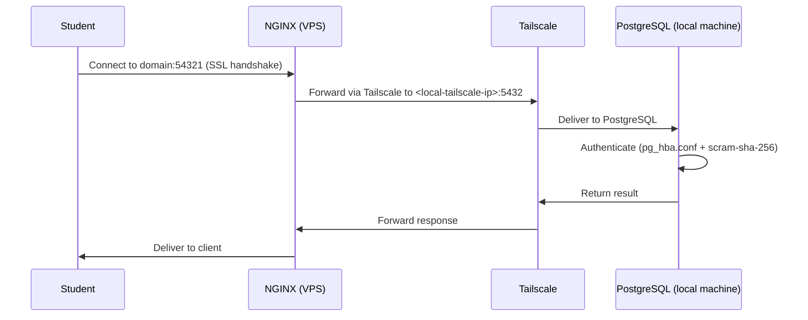
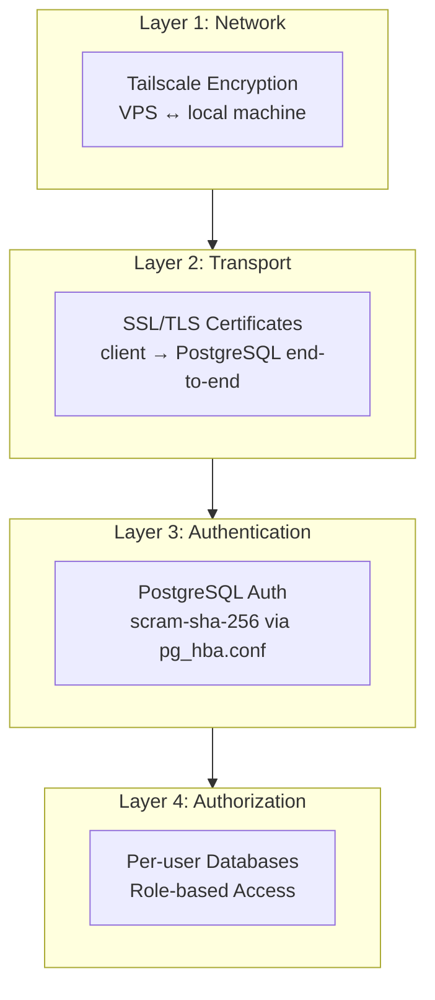
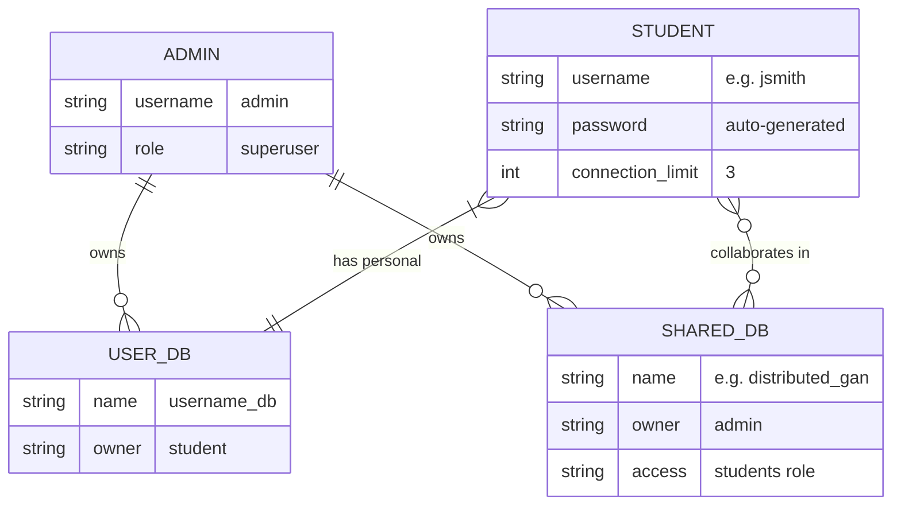
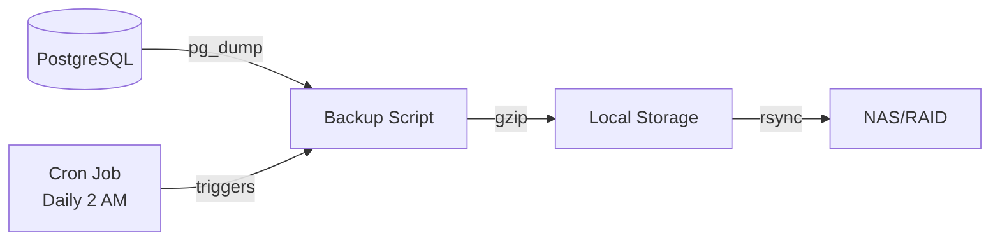
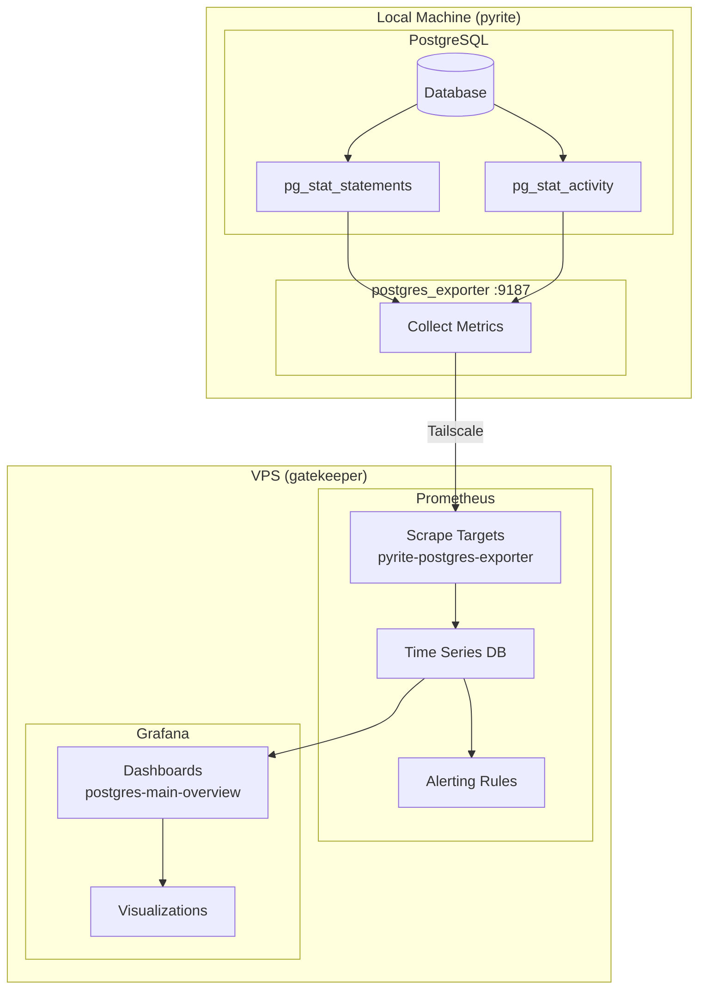

# Architecture

Detailed architecture diagrams for the self-hosted PostgreSQL setup.

## Network topology

The local machine and VPS are both nodes on a Tailscale tailnet. The VPS acts as the public entry point: NGINX receives incoming TCP connections on port 54321 and proxies them over Tailscale to PostgreSQL running on the local machine. There is no direct exposure of the database host to the internet.

## Docker services

Only PostgreSQL, `postgres-exporter`, and pgAdmin run in Docker on this host. Prometheus and Grafana run on the VPS (`gatekeeper`).

## Data flow

## Security layers

## Database structure

## Backup flow

## Monitoring stack

The local host only exports metrics. Prometheus (job `pyrite-postgres-exporter`) scrapes `$TAILSCALE_IP:9187` over Tailscale, and the `postgres-main-overview` dashboard lives in the central Grafana on the VPS. No Prometheus server or Grafana instance runs locally.

## Viewing these diagrams

These Mermaid diagrams render automatically on:
- GitHub (README, markdown files)
- GitLab
- Notion
- VS Code (with Mermaid extension)

Or paste into [mermaid.live](https://mermaid.live) to view/edit.
